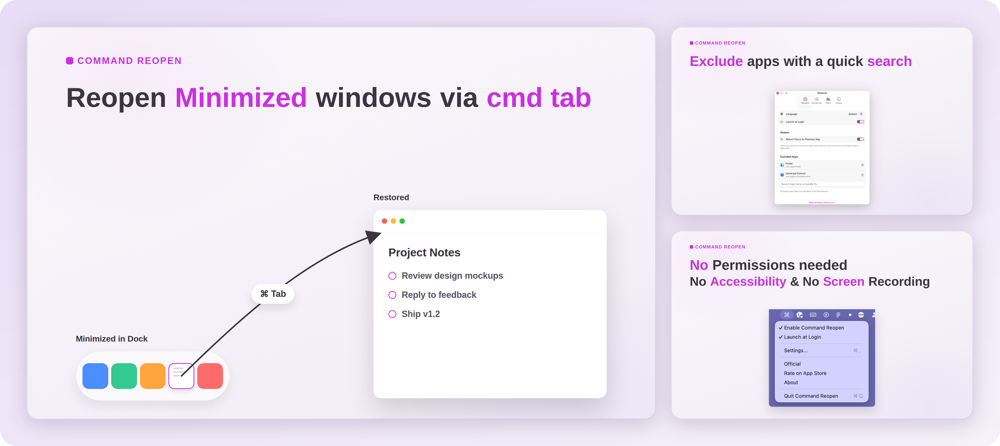

<p align="center">
  
</p>

<h1 align="center">Command Reopen</h1>

<p align="center">
  <strong>Cmd+Tab brings back minimized and closed windows on your Mac.</strong>
</p>

<p align="center">
  <b>English</b> | <a href="README_CN.md">简体中文</a>
</p>

<p align="center">
  <a href="https://github.com/Feng6611/mac-command-reopen/stargazers"></a>
  <a href="https://github.com/Feng6611/mac-command-reopen/releases/latest"></a>
  <a href="LICENSE"></a>
  
</p>

<p align="center">
  
</p>

> Why I built it: [Command Reopen: Make Cmd+Tab Bring Back Closed and Minimized Windows on Mac](https://kkuk.dev/en/posts/command-reopen/)

## Features

- **Restore minimized windows**: switch to an app with Cmd+Tab and its window comes back from the Dock.
- **Reopen closed windows**: if the app has no open window, Command Reopen asks it for a new one.
- **Native switcher**: no custom switcher or overlay; Cmd+Tab looks and works as before.
- **Return focus**: close or minimize an app's last window and focus goes back to your previous app.
- **Exclude apps**: excluded apps keep the default macOS Cmd+Tab behavior.
- **Menu bar utility**: runs in the background; the menu bar icon can be hidden.

## Quick Start

Requires macOS 13 or later.

**Install with one line (Direct, free)**

```bash
curl -fsSL https://raw.githubusercontent.com/Feng6611/mac-command-reopen/main/install.sh | bash
```

**Install a specific version, or uninstall**

```bash
curl -fsSL https://raw.githubusercontent.com/Feng6611/mac-command-reopen/main/install.sh | bash -s -- --version 1.5.5
curl -fsSL https://raw.githubusercontent.com/Feng6611/mac-command-reopen/main/install.sh | bash -s -- --uninstall
```

**Manual download**: [CommandReopen.dmg](https://github.com/Feng6611/mac-command-reopen/releases/latest/download/CommandReopen.dmg), then drag the app to Applications.

**Mac App Store**: [Command Reopen on the Mac App Store](https://apps.apple.com/app/apple-store/id6757333924?pt=128417926&ct=readme&mt=8).

## Direct vs Mac App Store

| | Direct (GitHub) | Mac App Store |
|---|---|---|
| Price | Free | Lifetime, $9.99 one-time purchase, 7-day free trial |
| Permissions | None required. Accessibility is optional, for Advanced Window Restore | None |
| Window restore | Standard reopen request; with Accessibility allowed, Command Reopen restores minimized windows itself, including in apps that ignore the reopen request | Standard reopen request |
| Updates | Run the install command again | Automatic, through the App Store |

Both versions have every core feature. If you want to support the developer, choose the Mac App Store version.

## Usage

1. Open Command Reopen once. It stays in the menu bar.
2. Minimize (`Cmd+M`) or close (`Cmd+W`) a window, then Cmd+Tab back to that app. The window comes back.
3. To leave an app alone, add it to **Excluded Apps** in Settings.
4. Direct only: to use Advanced Window Restore, allow Accessibility in **Settings › Advanced**, then turn on **Use Advanced Window Restore**. You can also turn on **Restore All Minimized Windows** and **Cycle Windows from Dock Click**.

Why this is needed:

| Shortcut | What happens | Does Cmd+Tab bring it back? |
|---|---|---|
| `Cmd+H` | Hides the app | Yes |
| `Cmd+M` | Minimizes the window to the Dock | **No** |
| `Cmd+W` | Closes the window | **No** |

## FAQ

**How does it work without permissions?**

It listens for `NSWorkspace.didActivateApplicationNotification`, checks the public window list (`CGWindowListCopyWindowInfo`) for a visible window, and only if there is none calls `NSWorkspace.openApplication(at:configuration:)`, the same request macOS sends when you click an app's Dock icon. See [CmdReopen/Features/Reopen](CmdReopen/Features/Reopen).

**Does every switch bring back a window?**

No. The app decides how to answer the reopen request, just as when you click its Dock icon. In the Direct version, Advanced Window Restore covers some apps that ignore it.

## Support

- Buy the [Mac App Store version](https://apps.apple.com/app/apple-store/id6757333924?pt=128417926&ct=readme&mt=8).
- [Buy me a coffee](https://buymeacoffee.com/kkuk).
- Star the repository or tell a friend.

## About

Built by [chenfeng](https://github.com/Feng6611). I make focused, permission-light Mac utilities and Obsidian plugins, including [Open in Terminal](https://github.com/Feng6611/Obsidian-open-in-Teminal) and [File Ignore](https://github.com/Feng6611/Obsidian-File-Ignore). Website: [commandreopen.com](https://commandreopen.com).

## Privacy

Window handling stays on your Mac. Both versions send anonymous product analytics (the GitHub build since 1.5.5), with no app names, window titles or personal data. See [PRIVACY.md](PRIVACY.md).

## License

[MIT](LICENSE)
