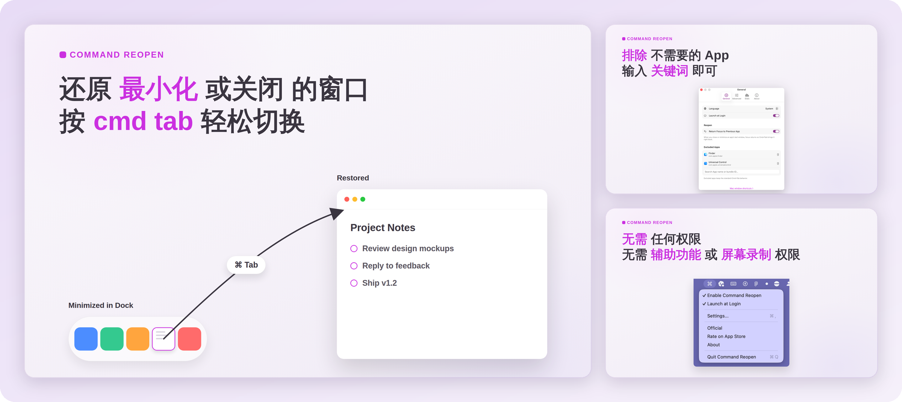

  

<h1 align="center">Command Reopen</h1>

  按 Cmd+Tab 自动唤回最小化与已关闭的窗口。

  <b>简体中文</b> | <a href="README.md">English</a>

  

  

> **推荐从 Mac App Store 安装**
>
> 推荐在 [Mac App Store](https://apps.apple.com/app/apple-store/id6757333924?pt=128417926&ct=readme&mt=8) 获取 Command Reopen。它体验更轻量、配置简单且无需辅助功能权限，支持应用商店自动更新，付费购买也能持续支持独立开发。
>
> 偏好免费与开源？可以通过 [GitHub Releases](https://github.com/Feng6611/mac-command-reopen/releases/latest) 下载 Direct 版。该版本在「设置 › 高级」中提供了可选的辅助功能设置，专用于解决部分无法响应系统标准恢复事件的第三方 App 最小化窗口唤回问题。请注意当前可下载的 1.2.1 压缩包早于这些可选设置，它们已包含在当前源码构建中。

---

## 为什么按 Cmd+Tab 切换应用后看不到窗口？

| 快捷键 | 效果 | Cmd+Tab 能切回来吗？ |
|---|---|---|
| `Cmd+H` | 隐藏应用 | 能 |
| `Cmd+M` | 窗口最小化到程序坞 | **不能** |
| `Cmd+W` | 关闭窗口 | **不能** |

Cmd+Tab 负责切换应用。最小化的窗口可能会留在 Dock 中，关闭的窗口也会保持关闭。

当应用没有可见窗口时，Command Reopen 会请求 macOS 重新打开一个窗口。具体如何响应由该应用自行决定。

## 版本对比

| 版本 | Mac App Store 版 | Direct 版 (GitHub) |
| :--- | :--- | :--- |
| **下载途径** | [App Store 页面](https://apps.apple.com/app/apple-store/id6757333924?pt=128417926&ct=readme&mt=8) | [Releases 最新发布](https://github.com/Feng6611/mac-command-reopen/releases/latest) |
| **窗口恢复方式** | 由 macOS 请求应用重开窗口 | 新版可用 AX 恢复最小化窗口。未开启或恢复失败时使用系统方式。 |
| **权限要求** | 无需辅助功能权限 | 开启高级窗口恢复时需要 |
| **更新方式** | App Store 自动更新 | 手动下载更新 |

## 功能

- 切换到应用时，自动从程序坞还原最小化窗口。
- 最后一个窗口已关闭的应用，切换时尝试重新开启新窗口。
- 核心功能零权限运行，使用原生系统工作区接口，无需辅助功能与屏幕录制权限。
- 关闭或最小化最后一个窗口后自动交还焦点，保持下一次 Cmd+Tab 切换自然。
- 原生切换器完全保持原样，不改变界面外观，不影响已有肌肉记忆。
- 支持按应用名称或 Bundle ID 排除指定应用，保留 macOS 默认切换行为。
- 静默常驻菜单栏，占用极低，支持隐藏菜单栏图标。

## 常见问题

**为什么 Mac 上 Cmd+Tab 不能还原最小化的窗口？**

macOS 把最小化的窗口当作你有意收起来的，所以 Cmd+Tab 只激活应用，窗口留在程序坞里。系统自带的办法是 Cmd+Tab 选中后按住 Option 再松开 Cmd，但一次只能还原一个窗口。

**Command Reopen 需要什么权限？**

核心功能不需要任何权限，辅助功能和屏幕录制都不用，因为它不直接干涉其他应用的窗口。它通过 `NSWorkspace.didActivateApplicationNotification` 获知切到了哪个应用，再用公开的 CoreGraphics 窗口列表（`CGWindowListCopyWindowInfo`）查看是否有可见窗口；只有在没有任何可见窗口时，才通过 `NSWorkspace.openApplication(at:configuration:)` 请求应用重新打开窗口——这与点击程序坞图标触发的系统请求一致。代码位于 [CmdReopen/Features/Reopen](CmdReopen/Features/Reopen)。

**它会改变 Cmd+Tab 切换器吗？**

不会。原生切换器的外观和操作方式完全保持不变，Command Reopen 仅在选定应用之后介入。

**关掉的窗口也能恢复，而不只是最小化的？**

能。切到的应用如果一个窗口都没有，Command Reopen 会向其发送重新开启窗口的请求。

**每次切换都能保证出现窗口吗？**

不能。Command Reopen 仅在应用没有可见窗口时发出标准重开请求，具体如何响应取决于应用自身对重开事件的实现（与点击其程序坞图标一致）。

**可以对某些应用关闭这个功能吗？**

可以。在设置里把它们加入「排除 App」，这些应用就会保持系统默认的 Cmd+Tab 行为。

## 隐私

窗口处理和各应用的使用记录都只保存在你的 Mac 上。Mac App Store 版会上传匿名的产品分析数据（不含 App 名称、窗口标题和个人信息），GitHub 版不上传任何数据。详见 [PRIVACY.md](PRIVACY.md)。

## 关于作者

我是 [chenfeng](https://github.com/Feng6611)，专注打造轻量、少权限的 Mac 效率工具与 Obsidian 插件，包括 [Open in Terminal](https://github.com/Feng6611/Obsidian-open-in-Teminal) 与 [File Ignore](https://github.com/Feng6611/Obsidian-File-Ignore)。
